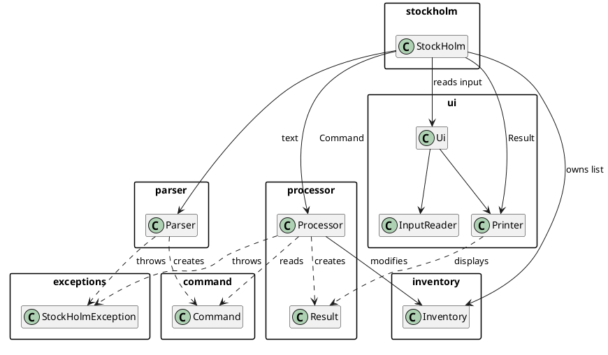
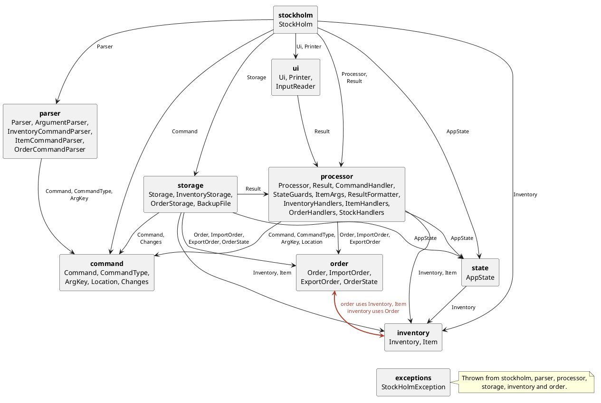
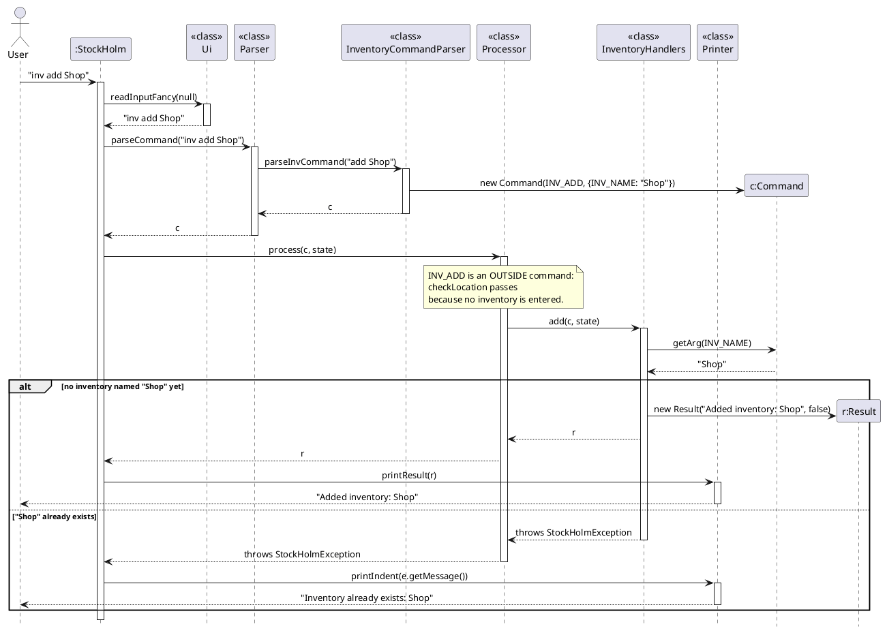
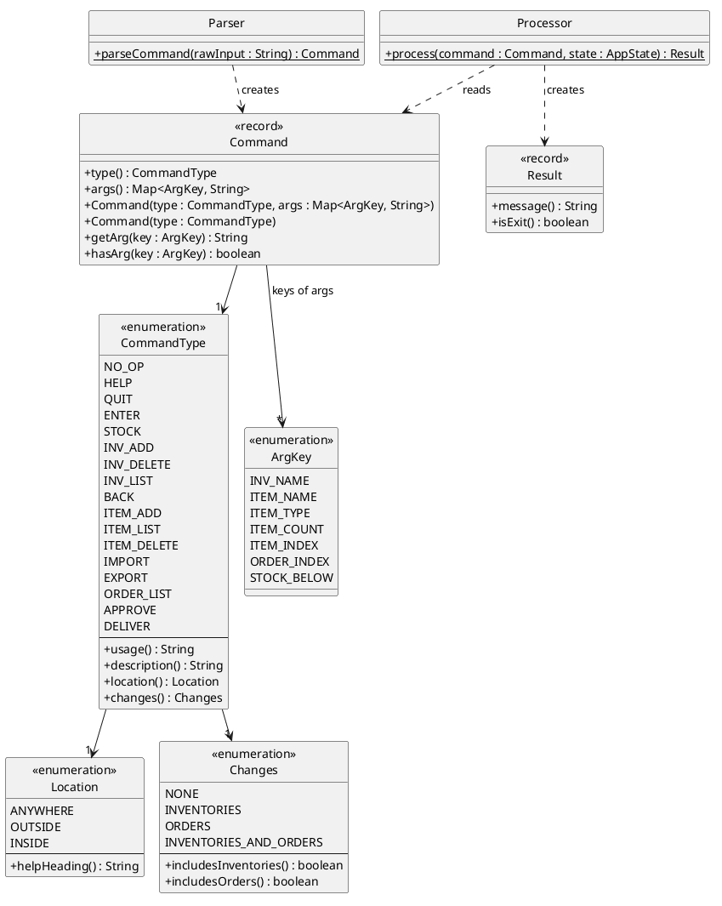
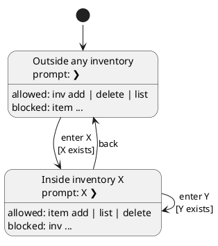
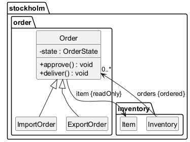
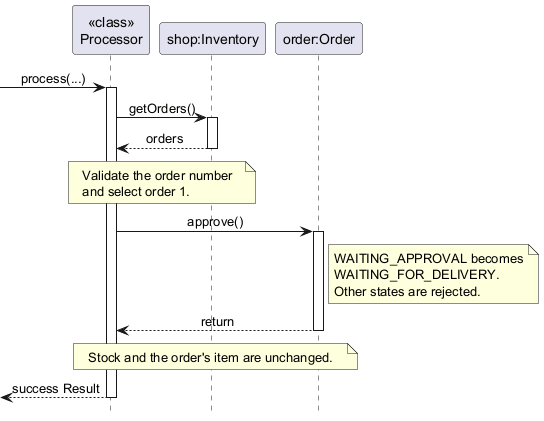

# Developer Guide

## Acknowledgements

* Project structure and build setup adapted from the [SE-EDU](https://se-education.org) project template.
* [Gson](https://github.com/google/gson): JSON library, used by `InventoryStorage` to save inventories.
* [JUnit 5](https://junit.org/junit5/): unit testing.
* [Checkstyle](https://checkstyle.org/): code style checks.
* [Gradle Shadow plugin](https://gradleup.com/shadow/): packages the app into a single runnable `stockholm.jar`.

## Design & implementation

### Architecture



StockHolm loads saved inventories and orders through `Storage.load(state)` before starting
the command loop in `StockHolm.main`. The load result includes warnings about skipped entries and a summary of what
was loaded, displayed through `Printer`. A save file that cannot be read stops startup to avoid overwriting data
that was not loaded.

StockHolm is a command-line app built around one loop in `StockHolm.main`:

1. **Read**: `Ui.readInputFancy(inventoryName)` shows the prompt and returns the line the user typed.
2. **Parse**: `Parser.parseCommand(line)` turns the text into a `Command`.
3. **Process**: `Processor.process(command, state)` runs the command against the `AppState` and returns a `Result`.
4. **Print**: `Printer.printResult(result)` shows the result. The loop stops once `result.isExit()` is `true`.
5. **Save**: `Storage.saveAfterCommand(command, state)` saves the inventories and/or orders the command changed.
   It runs only if processing succeeded, and after printing, so a save failure never hides the command's output.

Each step has one job, so the classes stay small and easy to test:

| Component | Job | Never does |
|---|---|---|
| `Parser` | Checks **syntax** (unknown command, missing argument, malformed number) | Look at inventory data |
| `Processor` | Enforces **business rules** (e.g. no duplicate inventory names) | Read input, parse text, print, or persist data |
| `Storage` | Restores saved data and saves successful changes through `InventoryStorage` and `OrderStorage` | Process commands or print |
| `Printer` | Decides **how** output looks | Decide what happened |
| `AppState` | **Holds the data**: all inventories and the current one | Contain business rules |
| `StockHolm` | Creates the `AppState` and runs the loop | — |

`Parser` and `Processor` hold no state of their own; all their methods are `static`.

Any user-facing error is thrown as a `StockHolmException`, from the Parser, Processor, or Storage.
The main loop catches it in a single place and prints its message, so you never need to print errors yourself.

### Coupling between packages

The diagram below shows which packages depend on which. Each box is a package with its classes, and each arrow
means "some class in this package uses these classes of that package". Arrows into `exceptions` are left out because
almost every package throws `StockHolmException`.



* **Dependencies point downwards.** `stockholm` (the main loop) sits on top and uses every layer. `command`,
  `state`, `order` and `inventory` are at the bottom and never use the packages above them, so the data model can
  be tested without the parser, processor, UI or storage.
* **`parser` only depends on `command`** (plus `exceptions`). It never sees inventory data, which is why parsing
  needs no `AppState`. `processor` and `storage` are the only packages that touch `order` and `inventory` directly.
* **`order` and `inventory` depend on each other** (red arrow): an `Inventory` holds its `Order`s, and an `Order`
  holds an `Item` and reads its inventory's name when it is created. Because of this cycle, neither package can be
  used or tested without the other, so check both when changing either one.
* **`storage` and `ui` use `processor.Result`**, and `storage` also uses `command.Changes` (from
  `CommandType.changes()`) to decide what to save after each command.
* The most-used classes are `StockHolmException` (used by 16 classes), `Command` (13) and `Inventory` (12).
  The classes that use the most others are `Processor` (12), `OrderHandlers` (11), `Storage` (10) and `StockHolm`
  (10), so they are the ones most likely to change when another class changes. Most of `Processor`'s are its own
  handler classes: outside the `processor` package it only uses `Command`, `CommandType`, `Location`, `AppState` and
  `StockHolmException`. The business logic that touches `order` and `inventory` lives in the handler classes.

### Flow of one command

The sequence diagram below shows `inv add Shop`, both when it succeeds and when the inventory already exists.



### Command component

Package `stockholm.command`: `Command`, `CommandType`, `ArgKey`, `Location`, `Changes`.



A `Command` is an **op code** plus **named arguments**:

* `CommandType` is the op code: which action to run (e.g. `ITEM_ADD`). Each constant also records:
    * `usage()`: its syntax, e.g. `item add NAME [--type=TYPE] [--count=COUNT]`, shown in Parser error messages.
    * `description()`: what it does, shown in `help`.
    * `location()`: where it may be used, a `Location` (`ANYWHERE`, `OUTSIDE` or `INSIDE` an inventory), checked by
      the Processor.
    * `changes()`: which saved data it changes, a `Changes` (`NONE`, `INVENTORIES`, `ORDERS` or
      `INVENTORIES_AND_ORDERS`), used by Storage to decide which files to save.

  `help` is generated from these fields: commands are grouped by location, in the order the constants are declared.
  `NO_OP` has no usage, so it is not listed.
* `ArgKey` names an argument (e.g. `ITEM_NAME`). Using an enum instead of strings means a mistyped key is a compile error.
* `args` is a `Map<ArgKey, String>` holding the arguments.

```java
// Command with arguments
Command add = new Command(CommandType.INV_ADD, Map.of(ArgKey.INV_NAME, "Shop"));
// Command without arguments
Command quit = new Command(CommandType.QUIT);

add.getArg(ArgKey.INV_NAME);   // "Shop"
add.hasArg(ArgKey.INV_NAME);   // true
quit.hasArg(ArgKey.INV_NAME);  // false
quit.getArg(ArgKey.INV_NAME);  // throws IllegalStateException
```

* Use `getArg` for **required** arguments. The Parser guarantees they are present, so a missing one is a bug, and
  `getArg` throws `IllegalStateException` to make it obvious.
* Use `hasArg` to check **optional** arguments before reading them, e.g. `--type` and `--count` of `item add`.
* `Command` is immutable: it is a `record`, and its map is copied on construction, so it cannot change afterwards.

Rules for arguments:

* **Values are strings.** The Parser checks their syntax (e.g. that a count is a positive number), and the Processor
  converts them when it uses them, e.g. `Double.parseDouble(command.getArg(ArgKey.ITEM_COUNT))`.
* **Commands carry names or positions, not objects.** To refer to an existing inventory or item, put its name (or its
  number in a list) in the command; the Processor looks up the object (see `AppState.findInventory` and
  `Inventory.findItem`). The Parser has no access to the data, so it cannot supply the real object.

### Parser component

`stockholm.parser.Parser` has one public method, `parseCommand(String rawInput)`. It splits the input into the
command word and the rest (`splitFirstWord`, which splits on any whitespace), then `switch`es on the command word and
hands the rest to the parser for that area. Only `Parser` is public; the other classes are package-private.

| Class | Parses |
|-------|--------|
| `Parser` | the command word, aliases, `help`, `quit`, `back` and blank input |
| `InventoryCommandParser` | `inv add\|delete\|list` (`parseInvCommand`) and `enter` (`parseEnter`) |
| `ItemCommandParser` | `item add\|list\|delete` (`parseItemCommand`) and `stock` (`parseStock`) |
| `OrderCommandParser` | `order list` (`parseOrderCommand`), `import`, `export`, `approve` and `deliver` |
| `ArgumentParser` | nothing on its own: the shared helpers below for names, options and numbers |

* Commands with the same syntax share a method: `ItemCommandParser.parseNameTypeCount` for `item add` and `import`
  (`NAME [--type=TYPE] [--count=COUNT]`), and `OrderCommandParser.parseOrderIndex` for `approve` and `deliver`
  (`INDEX`).
* The command parsers import the `ArgumentParser` helpers statically, so they call e.g. `requireArg(...)` directly.
* Usage hints in error messages come from `CommandType.usage()`, so each command's syntax is written in one place.
* Blank input becomes `NO_OP`, so pressing Enter does nothing.
* **Aliases** live in the `ALIASES` map (e.g. `bye`, `exit`, `close` → `quit`). Add new aliases there and nowhere else.
* `ArgumentParser.requireArg(value, label, usage)` throws a `StockHolmException` such as
  `Missing item name. Usage: item add NAME [--type=TYPE] [--count=COUNT]` if a required argument is empty.
  Use it for every required argument.

**Options.** `item add` takes a name followed by `--name=value` options, read by `ArgumentParser`:

```
item add "A4 Paper Case" --type="Stationery" --count=2
```

* A name in double quotes may contain spaces. An unquoted name runs until the first `--`.
* `splitNameAndOptions(arguments, label, usage)` separates a leading (optionally quoted) name from the options after
  it. It is shared by `item add`, `import` and `stock`; reuse it for any command of the form `NAME [--option=value]...`.
* `parseOptions(text, usage, allowed)` reads any number of options into a `Map<String, String>`, in the order given.
  Values may be quoted to contain spaces (`--type="Office Supplies"`). It rejects text that is not an option, options
  given twice, and option names not in the `allowed` set. Reuse `parseOptions` for future commands with options.
* Numbers are checked with regular expressions before they are put into the command: `DECIMAL` for counts (positive,
  e.g. `2` or `2.5`; no sign or exponent) and `WHOLE_NUMBER` for item and order numbers.
  `requireIndex(value, label, usage)` wraps the `WHOLE_NUMBER` check and also rejects 0 and numbers too large for an
  `int`; it is used for every item or order number.
  `requirePositiveDecimal(value, label)` wraps the `DECIMAL` check and also rejects numbers too large to be a
  finite `double`; it is used for every `--count` and for `--below`.
  `export` also takes `--count`, but parses its own leading item number instead of using `splitNameAndOptions`.

### Processor component

`stockholm.processor.Processor.process(Command command, AppState state)` only dispatches. It first checks that the
command is used in the right place (`StateGuards.checkLocation(command.type().location(), state)`), then calls the
`CommandHandler` registered for `command.type()`. Only `Processor` and `Result` are public; the other classes are
package-private.

| Class | Handles |
|-------|---------|
| `Processor` | dispatch, `help`, `quit` and blank input (small lambdas in `createHandlers`) |
| `InventoryHandlers` | `inv add\|delete\|list`, `enter`, `back` |
| `ItemHandlers` | `item add\|list\|delete`, plus item helpers that `OrderHandlers` reuses (`countOrDefault`, `typeOrEmpty`, `requireItem`) |
| `OrderHandlers` | `import`, `export`, `order list`, `approve`, `deliver` |
| `StockHandlers` | `stock` |
| `StateGuards` | the location check and inventory lookups shared by the handlers (below) |

Every handler has the same signature, `Result handle(Command command, AppState state)` (the `CommandHandler`
interface), so `createHandlers` registers each one with a method reference:

```java
handlers.put(CommandType.ITEM_ADD, ItemHandlers::add);
```

* A handler either returns a `Result`, or throws a `StockHolmException` if a business rule is broken
  (e.g. `"Inventory already exists: Shop"`).
* `Result(String message, boolean isExit)` is a `record`. Use an empty message to print nothing,
  and `isExit = true` only for `QUIT`.
* A command type with no registered handler throws `"Command not supported yet: ..."`.
  `ProcessorTest.process_everyCommandType_hasHandler` fails if any `CommandType` is left unregistered.
* `process(Command, AppState)` only applies business rules and changes in memory. Persistence is handled separately
  by Storage after processing returns successfully, so business-rule tests need no file I/O.

**Where commands are allowed.** The user is either outside all inventories, or inside one after `enter`:



Each `CommandType` declares its `Location`, and `StateGuards.checkLocation` enforces it before any handler runs:

* `OUTSIDE`: throws `You are inside Shop. Use back to leave it first.` when inside an inventory.
* `INSIDE`: throws `You are not inside an inventory. Use enter NAME first.` when outside all inventories.
  Handlers for `INSIDE` commands can then use `state.getCurrentInventory()` directly.
* `ANYWHERE`: no check.

`StateGuards` also finds the inventory a command acts on:

* `requireNamedOrCurrentInventory(command, state, usage)` is for commands that work **anywhere** and take an optional
  inventory name (e.g. `stock`). It returns the inventory named by `ArgKey.INV_NAME` if the command has one, otherwise
  the current inventory, and throws `Missing inventory name. Usage: <usage>, or enter an inventory first.` if there
  is neither. It never changes the current inventory.

To look up an inventory by name, use `requireInventory(name, state)`, which throws `No such inventory: NAME`,
or `AppState.findInventory(name)`, which returns `null` instead.

**Item rules** (in `ItemHandlers.add` and `ItemHandlers.delete`):

* `item add` without `--count` adds 1; without `--type`, the type is empty and not shown.
* Adding an item whose name already exists **merges** it: the counts are added together. If a `--type` is given that
  differs from the existing item's type, the command is rejected so a type is never silently lost.
* `item delete N` uses the **one-based** numbers shown by `item list`; the handler converts to a zero-based index for
  `Inventory.removeItem`.
* Names are compared case-sensitively, so `Pen` and `pen` are different items (and inventories).

**Stock levels** (in `StockHandlers.show` and `showLowStock`):

* `stock` works **anywhere**: it gets its inventory from `requireNamedOrCurrentInventory`, so stock can be checked
  without entering an inventory.
* Items keep the numbers shown by `item list`, so a number seen in `stock` can be passed straight to `item delete`.
* The total number of units is summed with `BigDecimal`, so decimal counts add up exactly (`0.1 + 0.2` gives `0.3`).
* With `--below=COUNT`, only items whose count is **strictly** below `COUNT` are listed (an item with exactly `COUNT`
  is not low), and the totals line is left out.

### State component

`stockholm.state.AppState` holds everything the app remembers between commands:

* `getInventories()`: the list of all inventories (modifiable).
* `findInventory(String)`: the inventory with that name (case-sensitive), or `null`. Used by both the Processor and
  Storage.
* `getCurrentInventory()`: the inventory the user has entered, or `null`. `isInsideInventory()` checks this.
* `enterInventory(Inventory)` and `leaveInventory()` change the current inventory. Entering while already inside
  another inventory switches directly.

The Processor changes state when executing commands. At startup, `Storage.load` adds the saved inventories, then adds
restored orders to their owning inventories, creating inventories referenced by saved orders when necessary. `StockHolm` reads
`getCurrentInventory()` to show its name in the prompt.

### Inventory component

Package `stockholm.inventory`:

* `Inventory(String name)` is a named list of items, kept in the order they were added.
    * `getName()` is also how inventories are looked up.
    * `addItem(Item)`, `findItem(String name)` (returns `null` if missing), and `removeItem(int index)` (zero-based).
    * `addOrMerge(Item)` adds the item, or adds its count to the existing item with the same name, and returns the
      item that now holds the stock. Both `item add` and delivering an import order use it.
    * `checkCanMerge(Item)` returns `false` if an item with the same name has a different type (an empty type never
      conflicts). `addOrMerge` checks it first and throws `Item already exists with a different type: ...`, so a
      rejected merge changes nothing. Delivery checks it directly too, before `Order.deliver()` changes the order's
      state.
    * `getItems()` returns a **read-only** view; change items only through the methods above.
    * `addOrder(Order)` stores an order for this inventory without changing its stock.
      `getOrders()` returns a **read-only** view of orders in creation order.
* `Item(String name, String type, double count)`: the count is a `double` so items measured in e.g. kilograms work.
    * `addCount(double)` increases the count when an item is merged, using decimal addition so `0.1 + 0.2` gives `0.3`.
    * `reduceCount(double)` reduces validated stock using decimal subtraction to avoid rounding residue.
    * `toString()` gives the display form, e.g. `A4 Paper Case (Stationery) x2`, leaving out `( )` if the type is empty.
    * `Item.formatCount(double)` shows counts without a trailing `.0` (`2.0` → `2`, `2.5` → `2.5`).

### Order component

Package `stockholm.order`:



**Design concepts.** The diagram shows the implemented order types and their relationships to inventory data.
Only the lifecycle operations and main data relationships are shown, with `OrderState` represented as an attribute.
Constructors, accessors, source/destination fields, members of the inventory classes, and constructor-only dependencies
are omitted, along with the empty `TransferOrder` placeholder and unused date/notes fields.

* **Inheritance:** `ImportOrder` and `ExportOrder` extend the concrete `Order` class and inherit its item,
  source/destination accessors, and approval/delivery methods. Their constructors set the destination or source name.
  `Inventory` stores both subclasses in one collection of `Order` references. The subclasses do not override
  approval or delivery. They only override `getKindLabel()` (`"Import order"` / `"Export order"`), which `order list`
  and the order-created messages display. The Processor uses `instanceof` when delivery behaviour depends on the
  order type.
* **Encapsulation and state transitions:** `Order` keeps its state private and exposes `approve()` and `deliver()`
  to enforce `WAITING_APPROVAL` -> `WAITING_FOR_DELIVERY` -> `DELIVERED`, throwing `StockHolmException` for an invalid
  transition. This uses an enum and guarded methods, rather than the State design pattern with separate state classes.
  `REJECTED` and `CANCELED` are enum values that can be restored, but there are no commands to enter those states yet.
* **Associations and snapshots:** each order references one `Item` and one `OrderState`; an inventory holds zero or
  more orders in creation order. The Processor creates separate item snapshots so stock changes do not change an
  order's recorded count. The order's item reference is final, but `Item` itself is mutable. Subclass constructors
  read the inventory's name into `src` or `dst`; orders do not retain an `Inventory` reference.
* **Separation of responsibilities:** `Order` validates its lifecycle transitions, while the Processor coordinates
  stock changes and Storage handles persistence. Restoring an order supplies its saved state directly, so loading
  does not replay transitions or apply stock changes again.

**Implementation details:**

- `Order` holds an `Item` and its `OrderState`, accessible through `getItem()` and `getState()`. New orders start in `WAITING_APPROVAL`.
- `Order`, `ImportOrder`, and `ExportOrder` also accept an `OrderState` when restoring saved orders.
- `Order.approve()` changes `WAITING_APPROVAL` to `WAITING_FOR_DELIVERY` and rejects any other starting state.
- `ImportOrder(Item item, Inventory currInventory)` extends `Order`, sets `dst` to the current inventory's name
  during construction, and is stored in that inventory by the Processor.
- `import NAME [--type=TYPE] [--count=COUNT]` and `item add` are both parsed by `parseNameTypeCount`, which uses each
  command's own usage hint.
- `import` is an `INSIDE` command. The Processor creates a separate item with a default count of 1 and an empty type, and stores a new `ImportOrder`.
- Existing items and stock counts stay unchanged. Repeated imports create separate orders.
- `export INDEX [--count=COUNT]` uses the one-based item number displayed by `item list`. The Parser checks the item
  number and the optional positive `--count` (via `parseOptions`); the Processor resolves the item in the
  current inventory.
- `ExportOrder(Item item, Inventory currInventory)` extends `Order` and sets `src` to the current inventory's name
  during construction. The Processor rejects counts above available stock, deducts the exported count
  immediately, and stores a separate item snapshot in a `WAITING_APPROVAL` export order. An omitted count exports
  all current stock. Items with no remaining stock are removed, so subsequent item numbers are renumbered.
- Rejected exports leave stock and orders unchanged. Repeated exports use the remaining stock, and changes to
  inventory items do not alter previous orders' recorded counts.
- The normal `Result` and Printer flow displays the item's name, type, and formatted count.
- `order list` is parsed by `parseOrderCommand` and handled by `OrderHandlers.list`; it is an `INSIDE` command.
  It lists only the current inventory's orders in creation order, showing their kind, state, item name, type, and
  formatted count. It does not change orders or stock. Empty inventories report `No orders in NAME yet.`
- `Order.deliver()` changes `WAITING_FOR_DELIVERY` to `DELIVERED` and rejects any other starting state.
- `approve INDEX` uses the one-based number from `order list` in the current inventory. The Parser checks the
  number's syntax; the Processor checks that it exists and calls `Order.approve()`. Approval changes neither item stock
  nor the order's recorded item.
- `deliver INDEX` uses the one-based number from `order list` in the current inventory. The Parser checks the
  number's syntax; the Processor checks that it exists and calls `Order.deliver()`. For an import order, delivery
  adds or merges the ordered item into the current inventory's stock. For an export order, stock was already reduced
  when the order was created, so stock remains unchanged. Order dates and notes are not implemented yet.

**Order approval sequence.** The diagram below focuses on the core interactions for a successful `approve 1`.
It assumes the user has entered `Shop` and order 1 exists in `WAITING_APPROVAL`. Validation and invalid-state
rejection are summarised in notes.



1. `Processor.process` checks that `APPROVE` (an `INSIDE` command) is used inside an inventory before dispatching to
   `OrderHandlers.approve`. The handler reads `ORDER_INDEX` and calls `requireOrder(index, inventory)`, which obtains the
   current inventory's orders with `getOrders()`, checks the index against the list size, and selects
   `orders.get(index - 1)`. Being outside an inventory or supplying an
   out-of-range index raises `StockHolmException` before `Order.approve()` is called.
2. `Order.approve()` checks its own state. Only `WAITING_APPROVAL` can become `WAITING_FOR_DELIVERY`.
   Any other state raises `StockHolmException` without changing the order. The same inherited method handles
   import and export orders; approval changes neither stock nor the order's item snapshot.
3. On success, the handler returns `Result("Approved order 1 in Shop.", false)`, which `Processor` passes on. Display and persistence
   follow the normal command flow outside this diagram. Rejected approvals leave the order unchanged and skip saving.

### UI component

Package `stockholm.ui`:

* `InputReader.readLine()` reads one raw line from standard input. It returns `"quit"` when input ends
  (e.g. Ctrl+D), so the app always exits cleanly.
* `Printer` is the **only** class that writes to the screen:
    * `printResult(Result)` prints the message, or nothing if it is empty.
    * `printIndent(String)` prints indented text; every line of a multi-line message is indented.
    * `printBar()` prints a horizontal line as wide as the terminal (`$COLUMNS`), or 100 characters if that is unknown.
    * `printPrompt()` prints `❯ `; `printPrompt(String)` prints the current inventory first, e.g. `Shop ❯ `.
* `Ui` combines `Printer` and `InputReader` calls for common screens:
  `readInputFancy(String inventoryName)` (the prompt between two bars; pass `null` when outside an inventory),
  `printStarter()`, and `printEnding()`.

### Storage component

`stockholm.storage.Storage` owns an `InventoryStorage` and an `OrderStorage` and coordinates application persistence.

* The default constructor uses both default paths. `Storage(OrderStorage, InventoryStorage)` supports isolated
  persistence tests. There is deliberately no constructor taking only one, so tests cannot write to the real `data`.
* `load(AppState)` loads inventories first, then merges orders into them by inventory name (creating inventories
  referenced only by orders). It returns warnings followed by `Loaded X inventory(ies) and Y order(s).`.
  * A corrupted inventory file (`InventoryStorage.CorruptFileException`) is backed up; startup continues with no
    inventories, and orders still load.
  * If any inventory, item, or order row was skipped, that file is also backed up, since the next save drops
    those entries.
  * Backups are made by `BackupFile` (see below). A failed backup is reported as a message, not an error.
  * Any other read failure, of either file, raises a `StockHolmException`; startup stops before the command loop.
* `saveAfterCommand(Command, AppState)` saves after a successful command, according to `command.type().changes()`:
  * inventories when `includesInventories()`: after `INV_ADD`, `INV_DELETE`, `ITEM_ADD`, `ITEM_DELETE`, `EXPORT`, and
    `DELIVER`;
  * orders when `includesOrders()`: after `IMPORT`, `EXPORT`, `APPROVE`, `DELIVER`, and `INV_DELETE`.

  A new command declares what it changes in its `CommandType` constant; `Storage` needs no change.
  Rejected commands throw before this is called, so they never write a file.
* Both saves are attempted even if one fails. Failures raise one `StockHolmException` naming each file that
  failed and reporting that changes are already applied in memory. The previous save file is preserved if writing
  the temporary file fails.

### Inventory storage component

`stockholm.storage.InventoryStorage` handles the inventory JSON on behalf of Storage, using Gson.

* `DATA_FILE_PATH` is `./data/inventories.json`, relative to the working directory. A constructor accepting a
  `Path` supports isolated persistence tests.
* The format is defined by private records (`SavedData`, `SavedInventory`, `SavedItem`), not by `Inventory` and
  `Item`, so the model classes need no Gson annotations or no-arg constructors:
  `{"inventories": [{"name": "Shop", "items": [{"name": "Pen", "type": "", "count": 3.0}]}]}`.
  Orders and the currently entered inventory are not part of this file.
* `load()` returns `LoadResult` (inventories with items, warnings, inventory count). A missing file loads nothing.
  Invalid JSON, or no `inventories` list, raises `CorruptFileException` (an `IOException`); other read errors raise
  a plain `IOException`. Invalid entries are skipped with a warning: an inventory with a blank or repeated name or
  no `items`, or an item with a blank name or a missing, non-finite, or non-positive count. A missing `type` loads as `""`.
* `save(List<Inventory>)` uses the same temporary-file-then-atomic-move approach as `OrderStorage`.

### Backups

`stockholm.storage.BackupFile` (package-private) makes the backups for both save files.

* `create(Path)` copies the file to a timestamped sibling, e.g. `inventories.json.2026-10-13T14-03-22.bak` or
  `orders.csv.2026-10-13T14-03-22.bak`. Older backups are never replaced; a second backup in the same second
  gets a `-1`, `-2`, ... suffix.
* If an existing backup of the same file has identical contents, no copy is made and that backup is returned,
  so restarting repeatedly on the same bad file does not pile up copies.
* `create(Path, Clock)` takes the time source, so tests can use a fixed clock for predictable names.
* Backups are not deleted automatically; they are only made when loading finds a problem.

### Order storage component

`stockholm.storage.OrderStorage` handles the order CSV on behalf of Storage.

* `DATA_FILE_PATH`, at the top of the class, is the developer-configurable final default path:
  `./data/orders.csv`, relative to the working directory. Launch from the project root to place `data`
  beside `src`. A constructor accepting a `Path` supports isolated persistence tests.
* The file used to be `./data/OrdersData.csv` (`LEGACY_DATA_FILE_PATH`). If only the legacy file exists, `load()`
  first moves it to `DATA_FILE_PATH`, so existing orders carry over; if both exist, the legacy file is ignored.
  `OrderStorage(Path, Path)` takes both paths, so tests can check this without touching the real `data` folder.
* All inventories' orders share one UTF-8 CSV, with the header
  `Inventory,OrderState,ItemName,ItemType,ItemCount,Src,Dst`. The legacy header, which ends in lowercase
  `src,dst`, is also accepted on load. Rows retain creation order within each inventory.
  No order-kind field is stored: an empty `src` and matching `dst` imply an import; an empty `dst` and matching
  `src` imply an export. Other endpoint combinations are rejected until transfer orders are implemented.
* CSV quoting preserves commas, double quotes, Unicode, and whitespace. Each order occupies one physical line;
  line breaks in fields are rejected so malformed rows can be skipped independently. Counts must be positive
  and finite, names must not be blank, and states must match `OrderState` exactly.
* `load()` returns `LoadResult`: restored inventories containing only orders, warning messages with physical
  line numbers and the quoted erroneous rows, and the successful order count. Each malformed row raises an
  `IOException` internally, which the loader catches to collect the warning and continue. A missing file loads
  zero orders; other file errors propagate. Loading does not rewrite the file.
* `save(List<Inventory>)` validates every order, creates the directory if necessary, writes a temporary sibling,
  and replaces the target using an atomic move where supported (a regular replacement otherwise).
  Invalid order data and I/O failures raise exceptions. Temporary files are cleaned up after the attempt.
* Delivered imports are restored as delivered without re-adding their items to stock; stock itself comes from
  `InventoryStorage`. The `data` folder is ignored by Git.

### Not implemented yet

These exist as placeholders, so avoid depending on their current shape:

* The currently entered inventory is not saved; StockHolm always starts outside any inventory.
* `order.TransferOrder`; order dates and notes.

### Adding a new command

Example: a hypothetical `item rename INDEX NEW_NAME` command, used inside an inventory.

1. **Op code**: add `ITEM_RENAME` to `CommandType` with its usage, description, location and what it changes:
   `ITEM_RENAME("item rename INDEX NEW_NAME", "rename the item numbered in item list", Location.INSIDE,
   Changes.INVENTORIES)`. Its position among the `INSIDE` constants sets where `help` lists it, and `Changes`
   makes Storage save the inventory file after it.
2. **Argument keys**: reuse existing keys where they mean the same thing (`ITEM_INDEX`, `ITEM_NAME`), and add new ones
   to `ArgKey` only when needed.
3. **Parse it** in `ItemCommandParser`: add a `case "rename"` to `parseItemCommand` and a `parseItemRename` helper.
   (A new top-level command word also needs a `case` in `Parser.parseCommand`.) Check the syntax with
   `requireIndex` and `requireArg`, using `CommandType.ITEM_RENAME.usage()` as the hint, then build the command:
   ```java
   return new Command(CommandType.ITEM_RENAME, Map.of(
           ArgKey.ITEM_INDEX, index,
           ArgKey.ITEM_NAME, newName));
   ```
4. **Process it**: add `static Result rename(Command command, AppState state)` to `ItemHandlers`, and register it in
   `Processor.createHandlers` with `handlers.put(CommandType.ITEM_RENAME, ItemHandlers::rename)`. The location is
   already checked, so it can use `state.getCurrentInventory()` directly. It checks the index is in range (reuse
   `requireItem`) and the new name is not taken, throws a `StockHolmException` if not, and returns a `Result` with the
   message to show.
5. **Test it**: add cases to `ParserTest` (valid input and each syntax error; new shared helpers go in
   `ArgumentParserTest`) and `ProcessorTest` (success and each broken rule, including running it outside an
   inventory). Helpers such as `invCommand`, `itemAdd` and `enterNewShop` in those tests keep the tests short.
6. **Document it** in the User Guide, and add a manual test case below.

You never need to touch `StockHolm`, `Printer` or `Result` to add a command.

### Testing and conventions

* Use **Java 25**. If your default JDK is different, run `export JAVA_HOME=/path/to/jdk-25` first.
* Run all tests and style checks with `./gradlew test checkstyleMain checkstyleTest`.
* Test classes mirror the main package structure, e.g. `src/test/java/stockholm/parser/ParserTest.java`.
* Test method names follow `methodName_condition_expectedResult`, e.g. `parseCommand_invAddWithoutName_throwsException`.
* To test console output, redirect `System.out` to a `ByteArrayOutputStream` in `@BeforeEach` and restore it in
  `@AfterEach` (see `PrinterTest`).
* **Assertions** check things that can only go wrong through a bug (e.g. an item with a non-positive count, or a
  threshold the Parser should have rejected); user mistakes are reported with a `StockHolmException` instead.
  Assertions are enabled for `./gradlew run` and `./gradlew test`. When running the jar, add `-ea`:
  `java -ea -jar build/libs/stockholm.jar`. In IntelliJ, add `-ea` to the run configuration's VM options.
* **Logging** uses `java.util.logging`, one `LOGGER` per class (see `ItemCommandParser` and `StateGuards`).
  Log routine events at `FINE`, which is hidden by default, so logs never mix with the app's output. To see them, run with
  `-Djava.util.logging.config.file=logging.properties`, using a file such as:
  ```
  handlers=java.util.logging.ConsoleHandler
  stockholm.level=FINE
  java.util.logging.ConsoleHandler.level=FINE
  ```
* Diagram sources are in `docs/diagrams/*.puml`. After editing one, regenerate the PNG with
  `java -jar plantuml.jar -tpng -o ../images docs/diagrams/*.puml`
  ([download plantuml.jar](https://plantuml.com/download)).


## Product scope
### Target user profile

People who need to manage multiple inventories and keep track of the history of changes to them.

### Value proposition

StockHolm lets users manage multiple inventories from a fast, keyboard-driven CLI, 
with an approval-based order workflow that keeps stock accurate and a full audit trail of every change.

## User Stories

|Version| As a ... | I want to ... | So that I can ...|
|--------|----------|---------------|------------------|
|v1.0|new user|see usage instructions|refer to them when I forget how to use the application|
|v1.0|inventory manager|view the stock levels of any inventory without entering it|check stock quickly from anywhere|
|v1.0|inventory manager|list only the items that are running low|know what to restock|
|v2.0|user|mark a WAITING_FOR_DELIVERY import or export order as DELIVERED, triggering stock adjustment|keep inventory levels accurate once goods actually arrive|

## Non-Functional Requirements

{Give non-functional requirements}

## Glossary

* *glossary item* - Definition

## Instructions for manual testing

> These instructions are a starting point for testers; you are encouraged to try more cases, especially unusual input.
> Expected messages are shown exactly as the app prints them.

### Launch and shutdown

1. **Prerequisites**: Java 25 (`java -version`).
2. **Build** the jar from the project folder with `./gradlew shadowJar`. It is created at `build/libs/stockholm.jar`.
3. **Launch** with `java -jar build/libs/stockholm.jar`.
   Expected: `Hello, Welcome to StockHolm, your inventory manager program`, any malformed-order warnings,
   then `Loaded X inventory(ies) and Y order(s).`, a bar, and the prompt `❯`.
4. **Exit** with `bye` (or `quit`, `exit`, `close`). Expected: `See you next time`, and the app ends.
   Pressing Ctrl+D (end of input) also exits cleanly.

> **Data is saved.** For a fresh manual-test session, use a working directory with no existing `data` folder.
> Otherwise saved inventories are restored, so setup commands such as `inv add Shop` may report that the inventory
> already exists.

### Saving and restoring data

1. Launch from the project root. Run `inv add Shop`, `enter Shop`, `import Pen --count=2`, and `approve 1`.
   Inspect `data/orders.csv` immediately: it contains an import row in `WAITING_FOR_DELIVERY`.
2. Run `deliver 1`, then `export 1 --count=1`. The file updates after each command, recording the delivered import
   and a new pending export with `src=Shop` and an empty destination.
3. Quit and restart. Expected: `Loaded 1 inventory(ies) and 2 order(s).`. Run `enter Shop` and `order list`:
   both orders retain their item data and states. `item list` shows `Pen x1`: the delivered 2, minus the export.
4. Quit. Insert a line `invalid order row` after the CSV header. Restart: the warning
   `Skipped order on line 2 in ./data/orders.csv: "invalid order row" (Expected 7 CSV fields.)` appears,
   while the summary still reports two loaded orders. A timestamped `data/orders.csv.<timestamp>.bak` holds
   the file as it was. Restart again without changes: no new backup appears.
5. Create orders in another inventory, then leave it and delete `Shop`. Inspect the shared CSV:
   Shop's orders are removed and the other inventory's orders remain.
6. Quit. Replace the contents of `data/inventories.json` with `{broken` and restart. Expected: a message that the file
   is corrupted, `Original file copied to ./data/inventories.json.<timestamp>.bak. Starting with no inventories.`, and the
   summary `Loaded 0 inventory(ies) and N order(s).` Inventories that still have orders are recreated without items.
7. Quit. Write `{"inventories":[{"name":"Shop","items":[{"name":"Pen","count":-1},{"name":"Box","count":2}]}]}`
   to `data/inventories.json` and restart. Expected: `Skipped item 1 of Shop in ./data/inventories.json: Pen has a missing or non-positive count.`,
   a backup message, and `stock Shop` shows only `Box x2`.
8. Quit. Replace `data/inventories.json` with a folder of the same name and restart. Expected:
   `Cannot load inventories: ...`, and the app exits without showing the prompt.

### Sample data

Paste these lines one at a time after launching to get a ready-made state for the tests:

```
inv add Main Warehouse
inv add Shop
enter Shop
item add "A4 Paper Case" --type="Stationery" --count=2
item add Rice --count=2.5 --type=Food
item add Blue Pen
```

Expected after `item list`:

```
Items in Shop:
1. A4 Paper Case (Stationery) x2
2. Rice (Food) x2.5
3. Blue Pen x1
```

### Managing inventories

Run these **outside** any inventory (the prompt is `❯` with no name).

1. **Adding**
    1. `inv add Main Warehouse` → `Added inventory: Main Warehouse`. Names may contain spaces.
    2. `inv add Shop` twice → the second time: `Inventory already exists: Shop`.
    3. `inv add` → `Missing inventory name. Usage: inv add NAME`
2. **Listing**: `inv list` → `Inventories:` followed by a numbered list in the order added.
   With no inventories: `No inventories yet.`
3. **Deleting**
    1. `inv delete Shop` → `Deleted inventory: Shop`; it no longer appears in `inv list`.
    2. `inv delete Ghost` → `No such inventory: Ghost`
4. **Wrong subcommand**: `inv` or `inv rename Shop` → `Usage: inv add|delete|list [NAME]`

### Entering and leaving an inventory

Setup: `inv add Shop` and `inv add Main Warehouse`.

1. `enter Shop` → `Entered inventory: Shop`, and the prompt becomes `Shop ❯`.
2. `enter Main Warehouse` while inside Shop → `Entered inventory: Main Warehouse`; the prompt switches directly.
3. `back` → `Left inventory: Main Warehouse`, and the prompt becomes `❯` again.
4. `back` again (outside) → `You are not inside an inventory. Use enter NAME first.`
5. `enter Ghost` → `No such inventory: Ghost`; the prompt does not change.
6. `enter` → `Missing inventory name. Usage: enter NAME`

**Location rules:**

1. Inside `Shop`, run `inv list`, `inv add Office` or `inv delete Shop`.
   Expected for each: `You are inside Shop. Use back to leave it first.`, and nothing changes.
2. Outside any inventory, run `item list`, `item add Pen` or `item delete 1`.
   Expected for each: `You are not inside an inventory. Use enter NAME first.`

### Adding items

Setup: `inv add Shop`, then `enter Shop`.

1. **All options**: `item add "A4 Paper Case" --type="Stationery" --count=2` → `Added item: A4 Paper Case (Stationery) x2`
2. **Options in any order, decimal count**: `item add Rice --count=2.5 --type=Food` → `Added item: Rice (Food) x2.5`
3. **No options** (count defaults to 1, no type): `item add Blue Pen` → `Added item: Blue Pen x1`
4. **Quoted type with spaces**: `item add "Office Chair" --type="Office Supplies" --count=1`
   → `Added item: Office Chair (Office Supplies) x1`
5. **Merging** an existing item (after test 1): `item add "A4 Paper Case" --count=3`
   → `Added 3 to existing item: A4 Paper Case (Stationery) x5`. `item list` still shows it only once.
6. **Merging with a different type** (after test 2): `item add Rice --type=Grain`
   → `Item already exists with a different type: Rice (Food) x2.5.`
   The count stays at 2.5.
7. **Invalid input**. Each is rejected and nothing is added:

| Input | Expected message |
|---|---|
| `item add` | `Missing item name. Usage: item add NAME [--type=TYPE] [--count=COUNT]` |
| `item add "Unclosed --count=2` | `Missing closing quote in item name. Usage: ...` |
| `item add Pen --count=0` | `Count must be a positive number, e.g. 2 or 2.5: 0` |
| `item add Pen --count=abc` | `Count must be a positive number, e.g. 2 or 2.5: abc` |
| `item add Pen --colour=blue` | `Unknown option --colour. Usage: ...` |
| `item add Pen --count=1 --count=2` | `Option given more than once: --count` |
| `item add "Pen" blue` | `Invalid option: blue. Usage: ...` |

### Creating import orders

Setup: `inv add Shop`, then `enter Shop`.

1. `import "A4 Paper Case" --type=Stationery --count=2` prints:
   ```text
   Import order created:
   Item name: A4 Paper Case
   Item type: Stationery
   Item count: 2
   ```
   `item list` still reports `No items in Shop yet.` because the order awaits approval.
2. `import Pen` prints the name `Pen`, an empty type, and count `1`.
3. `import Rice --count=2.5 --type=Food` prints count `2.5` and type `Food`.
4. `item add Rice --type=Food --count=5`, then `import Rice --type=Food --count=2`.
   `item list` still shows `Rice (Food) x5`.
5. `back`, then `import Pen` reports `You are not inside an inventory. Use enter NAME first.`
6. **Invalid input**. Each is rejected and no order is created:

| Input | Expected message |
|---|---|
| `import` | `Missing item name. Usage: import NAME [--type=TYPE] [--count=COUNT]` |
| `import "Unclosed --count=2` | `Missing closing quote in item name. Usage: ...` |
| `import Pen --count=0` | `Count must be a positive number, e.g. 2 or 2.5: 0` |
| `import Pen --count=abc` | `Count must be a positive number, e.g. 2 or 2.5: abc` |
| `import Pen --colour=blue` | `Unknown option --colour. Usage: ...` |
| `import Pen --count=1 --count=2` | `Option given more than once: --count` |
| `import "Pen" blue` | `Invalid option: blue. Usage: ...` |

### Creating export orders

Setup: `inv add Shop`, then `enter Shop`, then `item add Rice --type=Food --count=2.5`.

1. `export 1 --count=1` prints:
   ```text
   Export order created:
   Item name: Rice
   Item type: Food
   Item count: 1
   ```
   `item list` shows `1. Rice (Food) x1.5`. `order list` shows an export order in `WAITING_APPROVAL`.
2. `export 1 --count=2` reports `Cannot export 2 of Rice; only 1.5 available.` Stock and orders stay unchanged.
3. `export 1` exports the remaining 1.5. `item list` reports `No items in Shop yet.` The two export orders
   retain counts 1 and 1.5. Giving the exact remaining count explicitly has the same effect.
4. `export 1` in the empty inventory reports
   `No item number 1. Shop has 0 item(s); use item list to see them.`
5. `export`, `export 0`, `export abc`, `export 1 --count=0`, `export 1 --count=NaN`, `export 1 2` (count without
   `--count=`), `export 1 --type=Food`, and `export 1 --count=1 --count=2` are rejected.
6. `back`, then `export 1` reports `You are not inside an inventory. Use enter NAME first.`
7. `enter Shop`, then `item add Rice --count=0.3`, then run `export 1 --count=0.1` and `export 1 --count=0.2`.
   The item is removed without a rounding residue, and both orders retain their individual counts.

### Listing orders

Setup: `inv add Shop`, then `enter Shop`.

1. `order list` reports `No orders in Shop yet.`
2. `import Rice --type=Food --count=2.5`, then `import Pen`, then `order list` prints:
   ```text
   Orders in Shop:
   1. Import order
      State: WAITING_APPROVAL
      Item name: Rice
      Item type: Food
      Item count: 2.5
   2. Import order
      State: WAITING_APPROVAL
      Item name: Pen
      Item type:
      Item count: 1
   ```
   `item list` still reports `No items in Shop yet.`
3. `back`, then `order list` reports `You are not inside an inventory. Use enter NAME first.`
4. `inv add Warehouse`, then `enter Warehouse`, then `order list` reports `No orders in Warehouse yet.`
   `enter Shop`, then `order list` shows the two original orders again.
5. `order`, `order add`, and `order list Shop` each report `Usage: order list`.

### Approving orders

Setup: `inv add Shop`, then `enter Shop`.

1. `import Pen --count=2`, then `order list` shows order 1 in `WAITING_APPROVAL`.
2. `approve 1` prints `Approved order 1 in Shop.`; `order list` now shows `State: WAITING_FOR_DELIVERY`.
   `item list` still reports `No items in Shop yet.`
3. `approve 1` again reports `Order is not waiting for approval (current state: WAITING_FOR_DELIVERY).`
4. `approve 2` reports `No order number 2. Shop has 1 order(s); use order list to see them.`
5. `approve`, `approve 0`, and `approve abc` are rejected without changing the order.
6. `back`, then `approve 1` reports `You are not inside an inventory. Use enter NAME first.`
7. `enter Shop`, `item add Rice --count=3`, and `export 1 --count=1` create export order 2 and reduce Rice to 2.
   `approve 2` changes that order to `WAITING_FOR_DELIVERY` while Rice remains at 2.

### Delivering orders

Setup: `inv add Shop`, then `enter Shop`.

1. `import Pen --count=2`, then `approve 1`. `order list` shows order 1 in `WAITING_FOR_DELIVERY`.
   `item list` still reports `No items in Shop yet.`
2. `deliver 1` prints `Delivered order 1 in Shop.`; `order list` now shows `State: DELIVERED`.
   `item list` now shows `1. Pen x2`.
3. `deliver 1` again reports `Order is not waiting for delivery (current state: DELIVERED).`
4. `deliver 2` reports `No order number 2. Shop has 1 order(s); use order list to see them.`
5. `import Pen --count=3`, `order list` shows order 2 in `WAITING_APPROVAL`.
   `deliver 2` reports `Order is not waiting for delivery (current state: WAITING_APPROVAL).`
   `approve 2`, then `deliver 2` prints `Delivered order 2 in Shop.`.
   `item list` now shows `1. Pen x5` (merged into existing item).
6. `export 1 --count=2` creates export order 3 and reduces Pen to 3.
   `approve 3`, then `deliver 3` prints `Delivered order 3 in Shop.`.
   `order list` shows order 3 in `DELIVERED`, and `item list` still shows `Pen x3`.
7. `deliver`, `deliver 0`, and `deliver abc` are rejected without changing the order.
8. `back`, then `deliver 1` reports `You are not inside an inventory. Use enter NAME first.`

### Viewing stock levels

Setup: the [sample data](#sample-data), then `back` (you are outside all inventories).

1. **Named inventory from outside**: `stock Shop` →
   ```
   Stock levels in Shop:
   1. A4 Paper Case (Stationery) x2
   2. Rice (Food) x2.5
   3. Blue Pen x1
   Total: 3 item(s), 5.5 unit(s)
   ```
   The prompt stays `❯`: `stock` does not enter the inventory.
2. **Current inventory**: `enter Shop`, then `stock` → the same output as test 1.
3. **Another inventory from inside**: while inside Shop, `stock Main Warehouse` → `No items in Main Warehouse yet.`,
   and the prompt stays `Shop ❯`.
4. **Low stock**: `stock Shop --below=2.5` →
   ```
   Items in Shop below 2.5:
   1. A4 Paper Case (Stationery) x2
   3. Blue Pen x1
   ```
   Rice (exactly 2.5) is not listed. `stock Shop --below=1` → `No items in Shop below 1.`
5. **Invalid input**. Each is rejected:

| Input | Expected message |
|---|---|
| `stock` (outside) | `Missing inventory name. Usage: stock [NAME] [--below=COUNT], or enter an inventory first.` |
| `stock Ghost` | `No such inventory: Ghost` |
| `stock Shop --below=0` | `Threshold must be a positive number, e.g. 2 or 2.5: 0` |
| `stock Shop --above=3` | `Unknown option --above. Usage: stock [NAME] [--below=COUNT]` |
| `stock "Main Warehouse` | `Missing closing quote in inventory name. Usage: stock [NAME] [--below=COUNT]` |

### Listing and deleting items

Setup: the [sample data](#sample-data) (you are inside Shop with 3 items).

1. **Listing**: `item list` → `Items in Shop:` followed by the numbered items, as in the sample data.
   In an inventory with no items (e.g. `enter Main Warehouse`, then `item list`): `No items in Main Warehouse yet.`
2. **Deleting**: `item delete 2` → `Deleted item: Rice (Food) x2.5`.
   Then `item list` shows the remaining items **renumbered** from 1: `1. A4 Paper Case ...`, `2. Blue Pen x1`.
3. **Number out of range**: `item delete 9` → `No item number 9. Shop has 2 item(s); use item list to see them.`
4. **Invalid number**:

| Input | Expected message |
|---|---|
| `item delete 0` | `Item number must be a positive whole number: 0` |
| `item delete abc` | `Item number must be a positive whole number: abc` |
| `item delete` | `Missing item number. Usage: item delete INDEX` |
| `item edit 1` | `Usage: item add\|list\|delete ...` |

### Other input

1. Pressing Enter on an empty line does nothing; the prompt is shown again.
2. `dance` → `Unknown command: dance`
3. Commands are case-sensitive: `QUIT` → `Unknown command: QUIT`

### Running many commands at once (optional)

To repeat a test quickly, put one command per line in a text file and send it as input:

```
java -jar build/libs/stockholm.jar < commands.txt
```

The typed commands are not echoed in this mode, so only the prompts and responses appear.
End the file with `bye`; if you don't, the app still exits when the input runs out.
