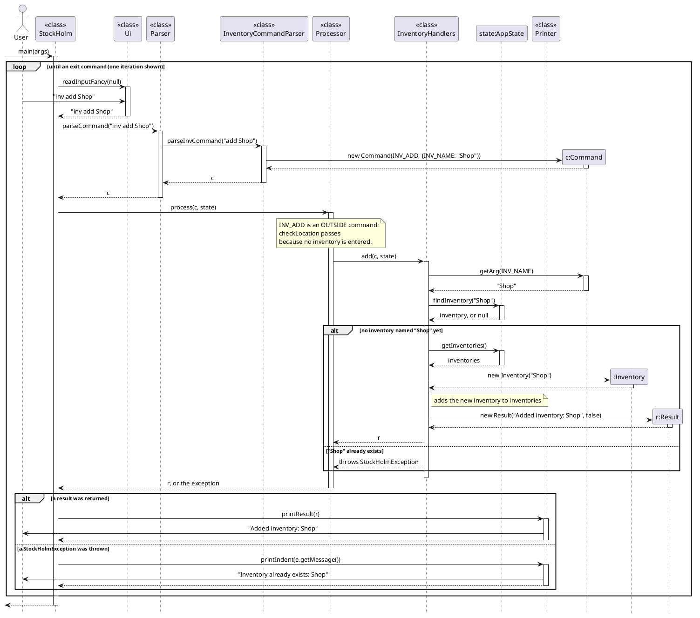

# Reyas Mohideen Fawaz - Project Portfolio Page

## Overview

StockHolm is a command-line application for managing stock across inventories. Orders track imports, exports and
transfers through approval and delivery; direct item commands support inventory maintenance. I worked on order
approval, inventory maintenance, data integrity, testing and technical documentation.

## Summary of Contributions

### Code contributed

[My attributed code on the tP Code Dashboard](https://nus-cs2113-ay2627-s1.github.io/tp-dashboard/?search=&sort=groupTitle&sortWithin=title&timeframe=commit&mergegroup=&groupSelect=groupByRepos&breakdown=true&checkedFileTypes=docs~functional-code~test-code~other&since=2026-09-18T00%3A00%3A00&filteredFileName=&tabOpen=true&tabType=authorship&tabAuthor=FawazRM23&tabRepo=AY2627S1-CS2113-W14-4%2Ftp%5Bmaster%5D&authorshipIsMergeGroup=false&authorshipFileTypes=docs~functional-code~test-code&authorshipIsBinaryFileTypeChecked=false&authorshipIsIgnoredFilesChecked=false)

### Enhancements implemented

* **Order approval** ([#21](https://github.com/AY2627S1-CS2113-W14-4/tp/pull/21)):
  added `approve INDEX` and its parser, state transition and tests. Only orders awaiting approval move to
  `WAITING_FOR_DELIVERY`; invalid or repeated approvals leave the order and stock unchanged.
* **Item editing** ([#58](https://github.com/AY2627S1-CS2113-W14-4/tp/pull/58)):
  added name and category edits that preserve count, minimum stock, list position and historical order snapshots.
  Integration tests cover duplicate names and persistence after a restart.
* **Bulk CSV import** ([#59](https://github.com/AY2627S1-CS2113-W14-4/tp/pull/59)):
  built a UTF-8 CSV reader for quoted commas and doubled quotes, with row-specific errors. I ran the same merge
  rules against a copy of the inventory before updating live stock. This catches conflicts between rows in the
  same file and prevents earlier valid rows from changing stock if a later row fails. Tests cover both rejection
  and persistence of a successful import.
* **Inventory rename** ([#60](https://github.com/AY2627S1-CS2113-W14-4/tp/pull/60)):
  kept the inventory and its items in place while updating both endpoints in saved order history. After
  [review feedback](https://github.com/AY2627S1-CS2113-W14-4/tp/pull/60#pullrequestreview-5696950799), I rejected
  renames that would turn a historical `A → B` transfer into `B → B` before either record changes, even when
  inventory `B` has been deleted. I also aligned quoted names with existing commands and added a regression test
  that checks order references after restart and verifies that deletion still cancels the order after another restart.
* **Input and stock safeguards** ([#78](https://github.com/AY2627S1-CS2113-W14-4/tp/pull/78),
  [#79](https://github.com/AY2627S1-CS2113-W14-4/tp/pull/79)):
  rejected extra text after commands that take no arguments. I checked for overflow before changing stock or order
  state. Tests cover item merges, CSV imports, transfer creation, order delivery, and refunds on rejection,
  cancellation and transfer destination deletion.
* **Order timestamps** ([#84](https://github.com/AY2627S1-CS2113-W14-4/tp/pull/84)):
  added creation and last status-change times to the order model, `order list` and the order CSV. I kept older
  CSV formats readable without inventing dates. Tests verify that unknown times survive a save and reload, and
  that malformed timestamps produce warnings while valid orders still load.

### Contributions to the User Guide

* Wrote the [approval](https://github.com/AY2627S1-CS2113-W14-4/tp/blob/master/docs/UserGuide.md#approving-an-order-approve),
  [item editing](https://github.com/AY2627S1-CS2113-W14-4/tp/blob/master/docs/UserGuide.md#editing-an-item-item-edit),
  [CSV import](https://github.com/AY2627S1-CS2113-W14-4/tp/blob/master/docs/UserGuide.md#importing-items-from-csv-item-import) and
  [inventory rename](https://github.com/AY2627S1-CS2113-W14-4/tp/blob/master/docs/UserGuide.md#managing-inventories-inv) instructions, including formats, examples and
  error cases ([#21](https://github.com/AY2627S1-CS2113-W14-4/tp/pull/21),
  [#58](https://github.com/AY2627S1-CS2113-W14-4/tp/pull/58),
  [#59](https://github.com/AY2627S1-CS2113-W14-4/tp/pull/59),
  [#60](https://github.com/AY2627S1-CS2113-W14-4/tp/pull/60)).
* Explained overflow rejection and order timestamps, including the `Unknown` display for older saved orders
  ([#79](https://github.com/AY2627S1-CS2113-W14-4/tp/pull/79),
  [#84](https://github.com/AY2627S1-CS2113-W14-4/tp/pull/84)). Documented that commands with no arguments reject
  extra text ([#78](https://github.com/AY2627S1-CS2113-W14-4/tp/pull/78)).
* Clarified when orders reserve or add stock and when direct item commands change stock, aligning the User Guide
  introduction with the README ([#89](https://github.com/AY2627S1-CS2113-W14-4/tp/pull/89)).

### Contributions to the Developer Guide

* Explained approval, item editing, atomic CSV import, order-reference updates on rename, overflow guards and
  timestamp persistence, with manual test cases in the
  [Developer Guide](https://github.com/AY2627S1-CS2113-W14-4/tp/blob/master/docs/DeveloperGuide.md) ([#21](https://github.com/AY2627S1-CS2113-W14-4/tp/pull/21),
  [#58](https://github.com/AY2627S1-CS2113-W14-4/tp/pull/58),
  [#59](https://github.com/AY2627S1-CS2113-W14-4/tp/pull/59),
  [#60](https://github.com/AY2627S1-CS2113-W14-4/tp/pull/60),
  [#79](https://github.com/AY2627S1-CS2113-W14-4/tp/pull/79),
  [#84](https://github.com/AY2627S1-CS2113-W14-4/tp/pull/84)).
* Simplified the [architecture](../images/ArchitectureDiagram.png),
  [command class](../images/CommandClassDiagram.png),
  [package coupling](../images/CouplingDiagram.png) and
  [`inv add` sequence](../images/InvAddSequence.png) diagrams and their DG explanations. Corrected labels in the
  [location state](../images/LocationStateDiagram.png) and
  [low-stock alert activity](../images/LowStockAlertActivity.png) diagrams
  ([#86](https://github.com/AY2627S1-CS2113-W14-4/tp/pull/86)).
* Added order and inventory user stories, corrected timestamp examples, and updated manual testing expectations
  ([#89](https://github.com/AY2627S1-CS2113-W14-4/tp/pull/89)).

### Contributions to team-based tasks

* Verified stock and order workflows across the README, UG and DG for v2.1. I aligned the explanations of when
  stock is reserved or received, and corrected the expected output for timestamped orders and malformed saved rows
  ([#88](https://github.com/AY2627S1-CS2113-W14-4/tp/issues/88),
  [#89](https://github.com/AY2627S1-CS2113-W14-4/tp/pull/89)). I also added my
  [About Us entry](https://github.com/AY2627S1-CS2113-W14-4/tp/pull/5).

### Review and mentoring contributions

* Reviewed [teammates' PRs](https://github.com/AY2627S1-CS2113-W14-4/tp/pulls?q=is%3Apr+reviewed-by%3AFawazRM23+-author%3AFawazRM23): flagged a startup failure when loading an invalid minimum
  ([#41](https://github.com/AY2627S1-CS2113-W14-4/tp/pull/41#discussion_r4357108511)); requested saved rejection
  reasons and retention of CI ([#46](https://github.com/AY2627S1-CS2113-W14-4/tp/pull/46#discussion_r4385187082),
  [CI comment](https://github.com/AY2627S1-CS2113-W14-4/tp/pull/46#discussion_r4385197984)); and requested clearer
  transfer instructions and a class-diagram update
  ([#54](https://github.com/AY2627S1-CS2113-W14-4/tp/pull/54#discussion_r4409678045),
  [diagram comment](https://github.com/AY2627S1-CS2113-W14-4/tp/pull/54#discussion_r4409705354)).
* In [#75](https://github.com/AY2627S1-CS2113-W14-4/tp/pull/75#discussion_r4442091592), reproduced how two saved names
  that cleaned to `Shop` could cause an export refund to go to the wrong inventory. In the
  [follow-up review](https://github.com/AY2627S1-CS2113-W14-4/tp/pull/75#discussion_r4442599251), I showed how a
  restart could undo the repair if only inventories were saved. The author updated startup to save both files
  when names change.
* In [#64](https://github.com/AY2627S1-CS2113-W14-4/tp/pull/64), caught integer overflow in pagination,
  case-insensitive filtering that disagreed with inventory lookup, and a missing `IndexedOrder` file that blocked
  the build. In [#91](https://github.com/AY2627S1-CS2113-W14-4/tp/pull/91#discussion_r4450164343), flagged missing
  and reversed steps in sequence diagrams. Both reviews led to fixes.

### Contributions beyond the project team

* Reviewed [KeyboardWarrior's Developer Guide](https://github.com/NUS-CS2113-AY2627-S1/tp/pull/9), commenting on
  sequence order, activation notation, UML notes and a complexity explanation.

## User Guide extracts

### Importing items from CSV

Adds many items to the current inventory from a UTF-8 CSV file. The first row must be exactly
`name,type,count,minCount`. Quote a field containing a comma or a double quote; write a double quote twice inside
a quoted field. `type` and `minCount` may be empty. An empty minimum means no minimum for a new item and leaves an
existing item's minimum unchanged.
Unlike an [import order](../UserGuide.md#creating-an-import-order-import), this command updates stock immediately and creates no order.

Format: `item import CSV_PATH`

* Put the path in double quotes if it contains spaces, for example `item import "data/new items.csv"`.
  Relative paths start from the folder StockHolm is run from.
* Names must be nonblank. Names and types must each fit on one line. Counts must be positive decimals, and minimums
  must be zero or positive decimals. Use `0` to clear an existing item's minimum.
* Existing items with the same name follow `item add` rules: compatible counts are added, but a conflicting category
  rejects the import. A supplied minimum updates that item's minimum.
* Every row is checked before anything is added. One invalid row rejects the whole file and reports its row number.

Example file:

```csv
name,type,count,minCount
"Blue, Fine Pen",Stationery,3,5
Rice,Food,2.5,
```

`item import "data/new items.csv"` → `Imported 2 item row(s) into Shop.`

[CSV import in the User Guide](../UserGuide.md#importing-items-from-csv-item-import)

### Renaming an inventory

* For `inv rename`, quote `OLD_NAME` if it contains spaces, e.g. `inv rename "Main Warehouse" Central Warehouse`.
  `NEW_NAME` may contain spaces with or without quotes. Both names have surrounding quotes and leading/trailing
  whitespace removed; e.g. `inv rename Shop " New Shop "` saves the new name as `New Shop`.
  Renaming keeps the inventory's items and updates its name in all orders and transfers, including completed history.
  A rename is rejected if it would make a past transfer's source and destination the same, even if that transfer
  was canceled after one inventory was deleted.

[Inventory commands in the User Guide](../UserGuide.md#managing-inventories-inv)

## Developer Guide extracts

### CSV import validation and persistence

* `item import CSV_PATH` asks `stockholm.storage.ItemCsvReader` to validate the UTF-8 header
  (`name,type,count,minCount`) and every CSV row. `ItemHandlers.importCsv` then applies the rows to a copy of the
  inventory first, using `addOrMerge` to catch type conflicts and count overflow. Only after the preview succeeds are
  the rows applied to the real inventory, so a bad row changes nothing. A non-empty `minCount` sets the item's
  minimum. `Storage` then saves the inventories as JSON.

### Saving inventory renames and order references

* `saveAfterCommand(Command, AppState)` saves after a successful command, according to `command.type().changes()`:
  * inventories when `includesInventories()`: after `INV_ADD`, `INV_RENAME`, `INV_DELETE`, `ITEM_ADD`,
    `ITEM_DELETE`, `ITEM_IMPORT`, `ITEM_EDIT`, `ITEM_MIN`, `EXPORT`, `TRANSFER`, `REJECT`, `CANCEL`, and `DELIVER`;
  * orders when `includesOrders()`: after `INV_RENAME`, `INV_DELETE`, `IMPORT`, `EXPORT`, `TRANSFER`, `APPROVE`,
    `REJECT`, `CANCEL`, and `DELIVER`. Renaming updates order inventory names; deleting cancels the deleted
    inventory's open orders.

  A new command declares what it changes in its `CommandType` constant; `Storage` needs no change.
  Rejected commands throw before this is called, so they never write a file.

[Implementation details in the Developer Guide](../DeveloperGuide.md)

### Inventory creation sequence



[Diagram revision in PR #86](https://github.com/AY2627S1-CS2113-W14-4/tp/pull/86)
