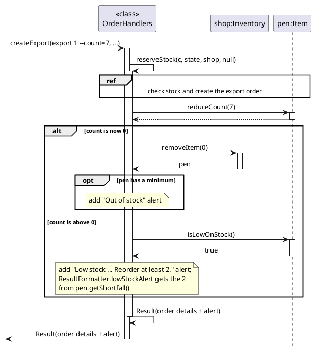
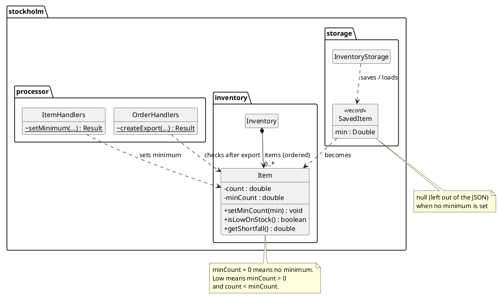

# Sanchit Garg - Project Portfolio Page

## Overview

StockHolm is a command-line app for managing several inventories from the keyboard. Stock enters and leaves an
inventory through import, export and transfer orders that are approved and delivered, so every change to stock goes
through a recorded order.

I owned StockHolm's **stock visibility** features, which tell users what they have, where it is, and what they are
about to run out of: `stock`, `find`, minimum stock levels with low-stock alerts, and `restock`. I built each one
end to end, from code and tests to its UG section and its DG design section and diagrams. For v2.1 I also audited
the whole UG and DG against the code.

### Summary of Contributions

#### Code contributed

[RepoSense link](https://nus-cs2113-ay2627-s1.github.io/tp-dashboard/?search=sanchitgarg08&sort=groupTitle&sortWithin=title&timeframe=commit&mergegroup=&groupSelect=groupByRepos&breakdown=true&checkedFileTypes=docs~functional-code~test-code~other&since=2026-09-18T00%3A00%3A00&filteredFileName=&tabOpen=true&tabType=authorship&tabAuthor=SanchitGarg08&tabRepo=AY2627S1-CS2113-W14-4%2Ftp%5Bmaster%5D&authorshipIsMergeGroup=false&authorshipFileTypes=docs~functional-code~test-code&authorshipIsBinaryFileTypeChecked=false&authorshipIsIgnoredFilesChecked=false)

Functional code, 59 JUnit tests and documentation, each delivered through its own PR from a separate branch of my fork.

#### Enhancements implemented

* **Stock levels: `stock [NAME] [--below=COUNT]`** ([#16](https://github.com/AY2627S1-CS2113-W14-4/tp/pull/16)):
  an inventory's items with exact `BigDecimal` totals, or only the items below a threshold. It works from anywhere
  without moving the user. After review I extracted the shared guard `requireNamedOrCurrentInventory`, which
  `restock` later reused unchanged.
* **Item search: `find [KEYWORD] [--type=TYPE]`** ([#40](https://github.com/AY2627S1-CS2113-W14-4/tp/pull/40)):
  case-insensitive name and type search. It covers the current inventory, or every inventory (grouped) when outside,
  so users can find an item without knowing where it is kept.
* **Minimum stock levels and low-stock alerts: `item min INDEX COUNT`**
  ([#41](https://github.com/AY2627S1-CS2113-W14-4/tp/pull/41)): `export` and `item min` alert the user the moment
  an item falls below its minimum, with the exact amount to reorder, and `stock` marks low items.
  * *Design:* `Item.isLowOnStock()` and `getShortfall()` are the single definition of "low" and of the reorder amount,
    so alerts, markers and lists cannot drift apart.
  * *Highlight:* minimums are stored as an optional field in the existing JSON file. Old save files load and re-save
    unchanged, and an invalid minimum is ignored with a warning instead of losing the item.
* **Restock list: `restock [NAME]`** (#41, extended in v2.1): every item below its minimum, with how much to
  reorder. Since v2.1 it checks every inventory at once when used outside one.
* **Defensive code** ([#30](https://github.com/AY2627S1-CS2113-W14-4/tp/pull/30)): enabled assertions for the team's
  Gradle runs, and added assertions and `FINE`-level logging, using the convention I documented in the DG.
* **Through the team's major refactor** ([#36](https://github.com/AY2627S1-CS2113-W14-4/tp/pull/36)): rebuilt `find`,
  `item min` and `restock` on the new per-domain parsers and handlers, merging rather than rebasing to keep history.
* **Testing:** 59 JUnit tests covering every success path and error message, decimal edge cases and save-file
  compatibility.

#### Contributions to the UG

* Wrote the `stock`, `find`, `item min` and `restock` sections, the low-stock notes under `export`, and their
  *Command Summary* rows.
* Wrote the Quick Start notes and FAQ on running the jar (terminal vs double-click, write-protected folders).
* v2.1 audit: checked every UG example against the running app and fixed *Listing orders* (an undocumented `--page`
  option, option rules and empty-list messages).

#### Contributions to the DG

* Wrote *Item search: `find`* and *Low-stock thresholds and alerts: `item min`, `restock`*: implementation,
  design rationale, alternatives considered (e.g. a field in `Item` vs a separate map, alerting per command vs after
  every command), limitations and extensions. Also wrote the *Stock levels* notes, the assertion and logging
  conventions, and the related user stories and manual tests.
* UML diagrams created: `FindSequence` (sequence), `LowStockClassDiagram` (class), `LowStockExportSequence`
  (sequence, `alt`/`opt` frames) and `LowStockAlertActivity` (activity).
* v2.1 audit of the whole DG against the code: updated `CommandClassDiagram`, `ArchitectureDiagram`,
  `CouplingDiagram` and `LocationStateDiagram`, fixed stale references and manual-test outputs, and wrote the
  *Non-Functional Requirements* and *Glossary*.

#### Contributions to team-based tasks

* Opened and tracked issues [#8](https://github.com/AY2627S1-CS2113-W14-4/tp/issues/8),
  [#29](https://github.com/AY2627S1-CS2113-W14-4/tp/issues/29) and
  [#37](https://github.com/AY2627S1-CS2113-W14-4/tp/issues/37)–
  [#39](https://github.com/AY2627S1-CS2113-W14-4/tp/issues/39).
* Enabled assertions in `build.gradle` for the team; updated the UG for v2.0
  ([#52](https://github.com/AY2627S1-CS2113-W14-4/tp/pull/52)); audited the UG, DG and product website for v2.1 and
  expanded the website's home page.

#### Review/mentoring contributions

* PRs reviewed, with non-trivial comments:
  * [#31](https://github.com/AY2627S1-CS2113-W14-4/tp/pull/31): advice on the assertions and logging added for
    defensive code.
  * [#34](https://github.com/AY2627S1-CS2113-W14-4/tp/pull/34): helped clarify documentation choices in the
    Developer Guide's order diagrams.

#### Contributions beyond the project team

* TODO: add the team whose DG you reviewed in the tutorial, and any bugs you reported in the PE dry run.

## Contributions to the Developer Guide (extracts)

**Low-stock alert on export** (sequence diagram):

**Where the minimum stock level lives** (class diagram):

