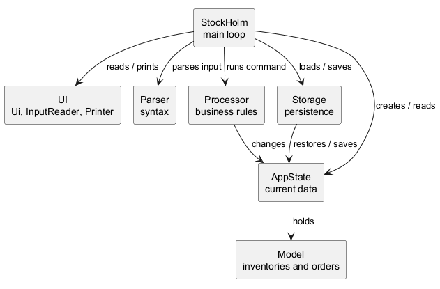
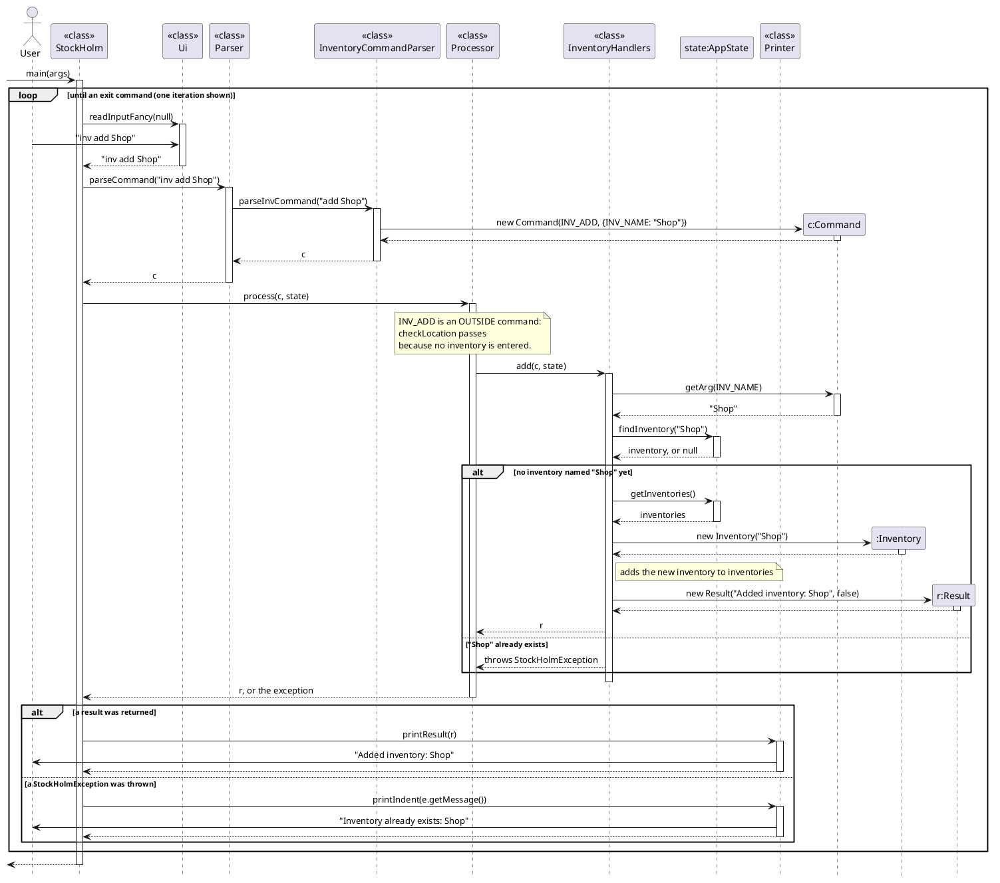
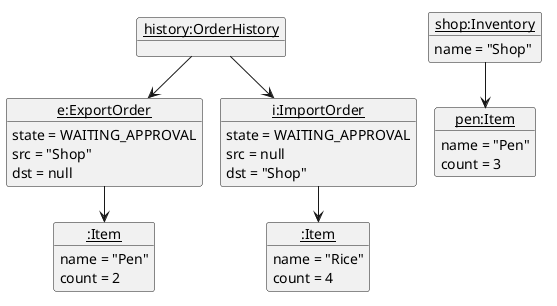
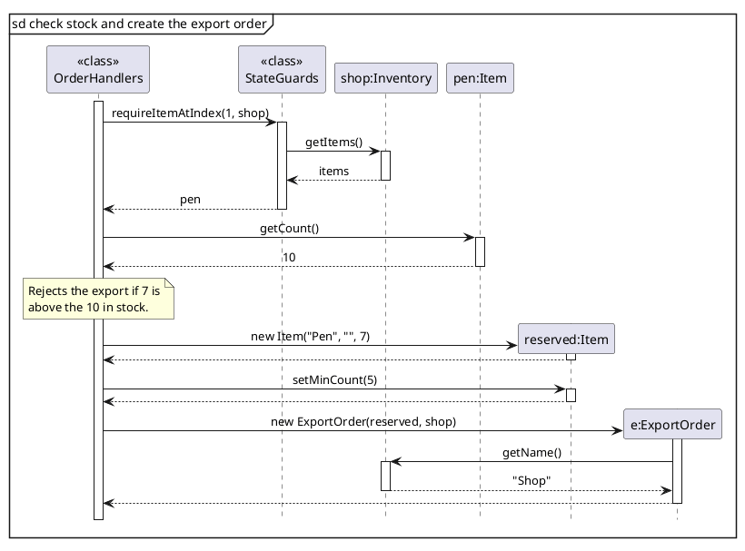

# Nguyen Tan Kiet - Project Portfolio Page

## Overview

StockHolm is a command-line app for managing several inventories from the keyboard. Stock enters and leaves an
inventory through import and export orders that are approved and delivered, so every change to stock is recorded.

I set up the project's foundation: the command pipeline (Parser, Processor, UI), the inventory and item model, and
data saving with backups. Later I refactored the code so teammates could add commands without editing shared classes,
and split the tests into unit, integration and end-to-end suites.

### Summary of Contributions

#### Code contributed

[RepoSense link](https://nus-cs2113-ay2627-s1.github.io/tp-dashboard/?search=yoosnk&breakdown=true)

#### Enhancements implemented

* **Core architecture** (PRs [#13](https://github.com/AY2627S1-CS2113-W14-4/tp/pull/13),
  [#15](https://github.com/AY2627S1-CS2113-W14-4/tp/pull/15)): replaced the Duke template with the StockHolm main loop
  and built the `Command` / `CommandType` / `Parser` / `Processor` / `Result` pipeline. The rest of the team built
  their features on this structure. Commands carry their arguments in a key-value map, so a new option needs no new
  parsing code, and each command declares where it can be used (inside an inventory, outside one, or anywhere), so
  the Processor checks this instead of each handler.
* **Inventory and item commands**: `inv add/delete/list`, `enter`, `back`, and `item add/list/delete`. Adding an
  existing item merges the counts. Decimal counts use `BigDecimal` arithmetic, so `0.1 + 0.2` stores `0.3`.
  Infinite and invalid counts are rejected.
* **`help` command** ([#26](https://github.com/AY2627S1-CS2113-W14-4/tp/pull/26)): generated from the `CommandType`
  enum, so the help text and error messages can never drift from the real syntax.
* **Inventory storage and backups** ([#27](https://github.com/AY2627S1-CS2113-W14-4/tp/pull/27)): saves inventories as
  JSON with Gson and loads them on startup. Each command declares which save files it changes, and only those are
  saved.
  * *Highlight:* if a save file is corrupted or partly unreadable, both save files get a timestamped `.bak` copy before
    anything is overwritten, and identical backups are not duplicated. If a file cannot be read at all, startup stops
    instead of overwriting data that was not loaded.
* **Large refactor** ([#36](https://github.com/AY2627S1-CS2113-W14-4/tp/pull/36)): split the growing Parser and
  Processor into parsers and handlers per domain (inventory, item, order, stock, find), and moved usage text,
  location rules and save rules onto `CommandType`. This removed duplicated validation logic: adding a command now
  touches the enum, one parser and one handler.
* **Global order history** ([#48](https://github.com/AY2627S1-CS2113-W14-4/tp/pull/48)): moved orders out of each
  inventory into one `OrderHistory`, so orders survive when their inventory is deleted and can be listed from anywhere.
  `reject`, `cancel` and `deliver` now check the order's state before changing stock, so a failed command changes no
  data.
* **Loading hand-edited save files** ([#75](https://github.com/AY2627S1-CS2113-W14-4/tp/pull/75)): inventory names
  are cleaned of quotes and padding on load, and blank or duplicate names are renamed with a number instead of being
  dropped. Orders follow their renamed inventory, so a bad hand edit never loses inventories or orders.
* **Test suite restructure** ([#83](https://github.com/AY2627S1-CS2113-W14-4/tp/pull/83),
  [#87](https://github.com/AY2627S1-CS2113-W14-4/tp/pull/87)): split the large test classes into 277 unit, 202
  integration and 9 end-to-end tests, each with its own Gradle source set, and added a JaCoCo coverage report
  (96% of lines, 90% of branches).
  * *Highlight:* the end-to-end tests run the shipped jar as a separate process, typing commands and checking the
    output and save files, so packaging mistakes are caught too.
* **Code quality**: fixes before the v1.0 release ([#28](https://github.com/AY2627S1-CS2113-W14-4/tp/pull/28)),
  and making `Order` abstract so `Order` itself cannot be created
  ([#91](https://github.com/AY2627S1-CS2113-W14-4/tp/pull/91)).

#### Contributions to team-based tasks

* Set up the project skeleton ([#13](https://github.com/AY2627S1-CS2113-W14-4/tp/pull/13)), replacing the Duke
  template, and improved the CI workflow ([#17](https://github.com/AY2627S1-CS2113-W14-4/tp/pull/17)) with Gradle
  caching, cancellation of outdated runs, and a timeout.
* Released [v1.0](https://github.com/AY2627S1-CS2113-W14-4/tp/releases/tag/v1.0).
* Opened issues to split work: [#6](https://github.com/AY2627S1-CS2113-W14-4/tp/issues/6),
  [#7](https://github.com/AY2627S1-CS2113-W14-4/tp/issues/7),
  [#23](https://github.com/AY2627S1-CS2113-W14-4/tp/issues/23),
  [#47](https://github.com/AY2627S1-CS2113-W14-4/tp/issues/47),
  [#50](https://github.com/AY2627S1-CS2113-W14-4/tp/issues/50),
  [#74](https://github.com/AY2627S1-CS2113-W14-4/tp/issues/74),
  [#81](https://github.com/AY2627S1-CS2113-W14-4/tp/issues/81),
  [#82](https://github.com/AY2627S1-CS2113-W14-4/tp/issues/82).

#### Review/mentoring contributions

* PRs reviewed, with non-trivial comments: [#16](https://github.com/AY2627S1-CS2113-W14-4/tp/pull/16),
  [#19](https://github.com/AY2627S1-CS2113-W14-4/tp/pull/19),
  [#22](https://github.com/AY2627S1-CS2113-W14-4/tp/pull/22),
  [#24](https://github.com/AY2627S1-CS2113-W14-4/tp/pull/24),
  [#30](https://github.com/AY2627S1-CS2113-W14-4/tp/pull/30),
  [#86](https://github.com/AY2627S1-CS2113-W14-4/tp/pull/86) (requested changes on the UML notation of the DG diagrams).

#### Contributions beyond the project team

* Reviewed the Developer Guide of team CS2113-T11-1
  ([PR #21](https://github.com/NUS-CS2113-AY2627-S1/tp/pull/21)), pointing out UML notation errors in a sequence
  diagram (unclear class vs. object participants, missing activation bars, solid return arrows), diagrams left as
  PlantUML code instead of images, and missing user stories, glossary and external libraries.

### Contributions to the UG

* Wrote the *Features* introduction and the command sections for `help`, `inv`, `enter`/`back`, `item add`,
  `item list`, `item delete`, `import`, `export`, `order list` and `bye`.
* Wrote *Saving the data*, including how timestamped backups work.

### Contributions to the DG

* Wrote *Architecture*, *Coupling between packages*, *Flow of one command*, *Command*, *Parser*, *Processor*,
  *State*, *Inventory*, *UI*, *Inventory storage* (including how inventory names are cleaned up on load) and
  *Backups*, plus *Not implemented yet* and *Testing and conventions* (the unit, integration and end-to-end test
  layout, and the coverage report).
* Wrote *Adding a new command*, a step-by-step walkthrough so teammates could add features without reading the whole
  Processor.
* UML diagrams: added `ArchitectureDiagram`, `CommandClassDiagram`, `CouplingDiagram`, `InvAddSequence`,
  `LocationStateDiagram`, the `OrderSnapshotObjectDiagram` object diagram and the `ExportReserveSequence` diagram.
  Checked every diagram against the course's UML notation ([#91](https://github.com/AY2627S1-CS2113-W14-4/tp/pull/91)):
  fixed activation bars and return arrows in `InvAddSequence`, used UML package notation and dependency arrows in
  `CouplingDiagram`, and showed `Order` as `{abstract}`, `Inventory`–`Item` as a composition, and a `ref` frame with
  a self-call in `LowStockExportSequence`.
* Manual testing instructions: launch and shutdown, saving and restoring data (including renamed inventories on
  load), sample data, inventory and item commands, other input, and running many commands at once.

#### Extracts

**Architecture**: the main loop and the components it coordinates.

**Flow of one command** (sequence diagram): `inv add Shop` through the UI, Parser and Processor, both when it
succeeds and when the inventory already exists.

**Orders and their item snapshots** (object diagram): each order holds its own copy of the item and only the name of
its inventory, so later stock changes never alter a recorded order.

**Checking stock and creating an export order** (sequence diagram, referenced by a `ref` frame in the low-stock
alert diagram):

